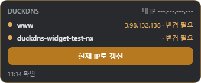
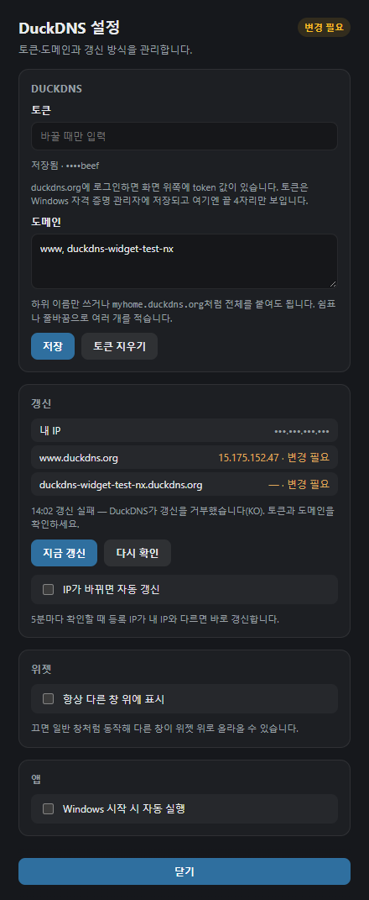

# DuckDNS Widget

Windows 바탕화면용 플로팅 위젯입니다. duckdns.org 홈페이지의 **update ip** 버튼을 위젯 버튼 하나로 옮겼습니다.

공유기 재부팅 등으로 공인 IP가 바뀌면 DuckDNS 도메인이 옛 IP를 가리킵니다. 위젯은 5분마다 내 공인 IP와 도메인에 등록된 IP를 비교하고, 어긋나면 주황색으로 알립니다. **현재 IP로 갱신** 을 누르면 바로 맞춰집니다.



도메인 한 줄에 점 · 이름 · 등록 IP · 상태가 붙습니다.

- **일치** (초록) — 등록 IP가 내 IP와 같습니다.
- **변경 필요** (주황) — 등록 IP가 다릅니다. 버튼이 주황으로 강조되고 위젯 테두리도 바뀝니다.
- **전파 중** (파랑) — 방금 갱신했고 DNS가 새 값을 돌려주길 기다리는 중입니다(최대 3분).
- **알 수 없음** (회색) — 내 IP나 DNS를 읽지 못했습니다.

헤더 오른쪽은 내 공인 IP, 맨 아래는 마지막 확인·갱신 시각입니다. 실패 원인은 아래 줄에 마우스를 올리면 보입니다.

## 일반 사용자 (추천)

1. 프로젝트 폴더의 **`시작.bat`** 을 더블클릭하세요.
2. 처음 한 번만 릴리스 빌드·설치가 진행되고, 이후에는
   `%LOCALAPPDATA%\DuckDnsWidget\duckdns-widget.exe` 가 바로 실행됩니다.
3. 바탕화면에 **DuckDNS Widget** 바로가기도 만들어 둡니다.
4. 위젯에서 **우클릭 → 설정** 으로 토큰과 도메인을 넣고 **저장** 하세요.
5. 같은 설정 창에서 부팅 시 자동 실행, IP가 바뀌면 자동 갱신을 켤 수 있습니다.

`target\debug\*.exe` 를 찾아 실행하면 **개발용**이라 화면이 비어 보이거나 안내 창만 뜹니다. 사용하지 마세요.

## 우클릭 메뉴와 설정 창

위젯 위에서 **우클릭**하면 **설정** 과 **종료** 두 항목이 나옵니다. 창이 도메인 수에 맞춰 줄어들어 항목이 늘면 메뉴가 잘리기 때문에, 나머지는 별도 설정 창으로 옮겼습니다.



- **DuckDNS** — duckdns.org에 로그인하면 화면 위쪽에 보이는 **token** 과, 갱신할 **도메인** 을 넣습니다. 도메인은 `myhome` 처럼 하위 이름만 써도 되고 `myhome.duckdns.org` 를 통째로 붙여도 됩니다. 쉼표나 줄바꿈으로 여러 개를 적습니다. 토큰 칸은 바꿀 때만 채우면 됩니다.
- **갱신** — 내 IP와 도메인별 등록 IP, 마지막 갱신 결과를 보여줍니다. **지금 갱신** 은 위젯 버튼과 같고, **다시 확인** 은 다음 확인 주기를 기다리지 않고 바로 비교합니다. **IP가 바뀌면 자동 갱신** 을 켜면 확인할 때 어긋난 도메인을 알아서 맞춥니다(기본 꺼짐).
- **위젯** — **항상 다른 창 위에 표시** 를 끄면 일반 창처럼 동작합니다.
- **앱** — **Windows 시작 시 자동 실행** 으로 부팅 시 자동 실행을 켜고 끕니다. 개발 모드에서는 바꿀 수 없어 비활성으로 표시됩니다.

오른쪽 위 배지는 전체 상태(일치 · 변경 필요 · 설정 필요 · 확인 실패)입니다. **닫기** 나 `Esc` 로 닫습니다.

설정 창은 열릴 때 내용 높이에 맞춰지고, 화면보다 길면 화면 안에 들어가게 줄어든 채 스크롤됩니다. **닫기** 는 창 아래에 붙어 있어 FHD처럼 세로가 짧은 화면에서도 늘 보입니다.

## 개발 실행

```powershell
npm install
npm run tauri dev
```

요구 사항: Windows, Node.js, Rust, Visual Studio C++ Build Tools, WebView2.

## 스크립트

| 명령 | 용도 |
|------|------|
| `시작.bat` / `npm run start:app` | 설치본 실행 (비개발자) |
| `npm run rebuild:app` | release 강제 재빌드·재시작 (작업 완료 후) |
| `npm run build:app` | 릴리스 빌드만 |
| `npm run tauri dev` | Vite + debug (개발) |
| `npm run make:icon` | 아이콘 재생성 |

Rust 단위 테스트는 `src-tauri` 에서 `cargo test` 로 돌립니다. 실제 네트워크·자격 증명 관리자를 쓰는 테스트는 `cargo test -- --ignored live` 로만 돕니다.

## 동작 방식

```
내 공인 IP   GET https://api.ipify.org                    (실패 시 https://1.1.1.1/cdn-cgi/trace)
등록 IP      GET https://cloudflare-dns.com/dns-query      (DoH, 실패 시 dns.google → 시스템 DNS)
갱신         GET https://www.duckdns.org/update?domains=a,b&token=…&verbose=true
```

- 갱신 요청에 `ip` 를 넣지 않습니다. 홈페이지 버튼처럼 요청을 보낸 PC의 IPv4를 DuckDNS가 감지해 씁니다.
- 등록 IP는 Windows·공유기 DNS 캐시를 피하려고 DoH로 읽습니다. 그래도 TTL(60초) 동안 옛 값이 보일 수 있어, 갱신 직후 3분은 **전파 중** 으로 표시합니다.
- 5분마다 확인합니다. 자동 갱신이 토큰 오류(KO)로 실패하면 30분 동안은 다시 시도하지 않습니다.

## 저장 위치

| 값 | 위치 |
|----|------|
| 토큰 | Windows 자격 증명 관리자 (`DuckDNS Widget`) |
| 도메인·자동 갱신 | `%LOCALAPPDATA%\DuckDnsWidget\config.json` |
| 마지막 갱신 기록 | `%LOCALAPPDATA%\DuckDnsWidget\last-update.json` |

## 주의

- IPv4만 다룹니다. DuckDNS의 자동 감지가 IPv4만 지원합니다.
- VPN을 켠 채 갱신하면 VPN 출구 IP가 등록됩니다. 홈페이지 버튼과 같은 동작입니다.
- 토큰은 화면에 끝 4자리만 보이고, 로그·에러 문구·설정 파일 어디에도 원문을 남기지 않습니다.
